# 嵌入式视角下的 AI 辅助编程入门指南

## 写在前面

这篇文章的内容，对至少 95% 的人来说都会显得超纲。如果在大学里按照课程体系逐项讲解，需求、设计、架构、版本管理、测试、审查和交付等内容会被拆成许多门课，持续多个学期。

工程是实践学科。真正掌握这些内容，主要靠大量实践。带着基本概念进入项目后，在需求变化、上下文压缩、复杂修改、Review、测试和发布中遇到具体问题，再回头查资料、调整方案。失败、返工和重新验证会不断修正原来的理解，这些认识随后又会作用到下一次实践。

文章已经尽量考虑不同的基础水平，但没有按零基础课程来写，也不可能只靠阅读就把一个从未做过工程的人教会。它更像一份可以反复查阅的引导：说明 AI 时代应该怎样学习、需要补哪些知识，以及进入工程实践前应当知道哪些基本常识。并不需要先学完一整套课程再开始，可以先带着这些常识进入项目，遇到问题时回来查阅。随着实践经验增加，重读相同章节往往会得到新的理解，形成常读常新的效果。

## 代码生成变便宜以后，复杂度管理成为主线

在在线评测系统（Online Judge，OJ）上，一道 C 题通常只要求用 `scanf` 读入数据，完成计算，再用 `printf` 输出结果。题面写明了输入格式、数据范围和小数位数，评测系统负责判断答案。提交后通过评测（Accepted，AC），这道题就结束了。

把同一套计算做成供别人使用的成绩查询工具，情况立刻不同。成绩从哪里导入，同名学生怎样区分，文件损坏后怎样处理，旧数据还能不能用，题面都没有答案。工具上线以后，还要继续加功能、修复错误（Bug），并交给别人维护。

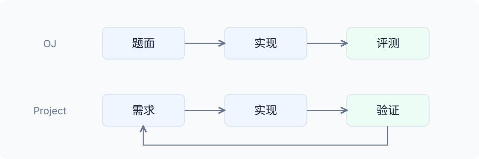

编程 Agent 是一种程序：它接收任务，调用模型决定下一步，再借助工具读写文件或运行命令。提出要求以后，它能读文件、写函数、运行程序，也能顺着报错继续修改。原先要一行一行敲出的代码，现在很快就能出现在编辑器里。

模型能力还会继续提高。长任务理解、修改范围和故障定位，都会随下一代模型变化。把这些阶段性能力当作主线，结论很快会过时。Agent 结对编程长期要处理的，是怎样在有限上下文里组织工程协作，以及怎样控制软件自身不断增长的复杂度。

一类复杂度来自模型的工作空间。上下文窗口有 Token 上限，规则、对话、源码和工具结果会不断累积；窗口接近上限后，就必须压缩。摘要或压缩状态可能丢掉关键约束、失败过的方案和未完成事项。信息出现缺口后，模型还可能用看似合理的内容补上空位，产生幻觉，也就是生成实际没有原始依据的回答。因此，Harness 要决定哪些资料进入上下文、以什么顺序出现、何时重新读取，以及压缩后怎样核验。

另一类复杂度来自软件本身。需求、接口、模块依赖、文件格式、兼容条件、测试、版本、发布和长期维护彼此关联，共同组成软件生命周期。Agent 让生成代码变快以后，项目能更快增加功能、改动更多文件，接口和依赖也会随之增多。代码写得更多，不会让设计、测试、发布和维护变简单。

这就是 Agent 结对编程需要管理的工程复杂度。这里的管理不是泛泛地分配人员或催促进度，而是组织有限上下文中的信息，控制每次任务的边界，安排实现、Review、测试、版本记录和发布，使连续修改后的系统仍然可以理解、验证和维护。

Agent 可以参与其中每一步，模型也会替掉一部分执行工作。最终仍要有人判断哪些信息必须保留、哪些复杂度可以接受、哪些修改能够进入项目。理解这条协作链路，要先看模型怎样把文字变成回答，再看 Agent 怎样取得工具、进入项目。

## 模型提供了什么能力

用户在聊天窗口输入问题或代码，模型就会给出回答、解释或按要求组织的内容。背后完成这些工作的计算程序，通常以语言模型（Language Model，LM）为基础；规模足够大时，叫作大语言模型（Large Language Model，LLM）。它们的共同特点是依据已有内容，一步一步预测后面的文字。

### 文本怎样进入模型

模型读一段文字时，要先把它切成许多小片段。每个片段叫词元（Token），负责切分的程序叫分词器（tokenizer）。把文本切成词元的过程叫词元化（tokenization）。

例如，“李四的成绩是92。”可能被切成“李四”“的”“成绩”“是”“92”“。”六个片段，于是这句话有六个 Token。一个 Token 不一定等于一个字，也不一定是一个完整单词。较长的英文单词可能被拆成几段，标点和空格也可能单独成片。具体怎样切，由分词器决定。

分词器还会给每个片段一个数字编号，叫词元编号（Token ID）。编号只用于识别片段，真正送入模型的计算表示在下一步生成。换一个分词器，同一段文字的切法和 Token 数都可能不同。

切分以后，文字还要变成模型能够计算的数字。这一过程叫向量嵌入（Embedding），也就是向量化：用一个数字数组表示一个 Token。例如，前面切出的“李四”可以简化表示为 `[0.2, -0.5, 0.8]`，这组按顺序排列的数字就叫向量。

自然语言到这里就变成了数字。每组数字可以看作抽象空间中的一个位置，这个空间叫向量空间。向量嵌入为文字建立数值表示，后面的计算便可以直接处理这些数字。

向量随后进入多层数值计算。每一步都要把同一段文字中不同位置的信息联系起来，才能判断前后关系；注意力机制负责完成这种关联。许多语言模型采用 Transformer 来组织这些多层计算，这种结构来自 2017 年的论文[《Attention Is All You Need》](https://arxiv.org/abs/1706.03762)。模型内部有大量训练中不断调整的数字（参数），输入向量会按照这些数字一层层计算，不断形成新的表示。

例如，回答“李四的数学成绩是多少”时，模型要同时考虑问题里的姓名和成绩表里的记录。注意力让一个位置能够参考其他位置的信息，再把关联后的结果继续交给后面的计算层。

多层计算结束后，模型会为每个可能出现的后续 Token 算一个概率。程序选出一个 Token，接在原文后面，再重复预测。回答就是这样一个 Token、一个 Token 地生成出来。

输入和输出都以 Token 为单位，所以上下文容量、回答长度和接口调用量常用 Token 计量。

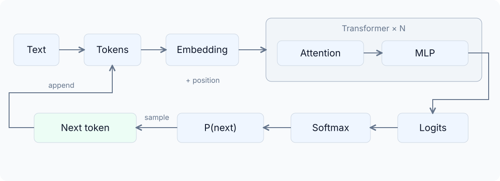

已有内容会影响后面的预测，这些可参考的信息叫上下文。加入项目源码、报错或要求，会改变模型做判断的依据。上下文窗口有容量限制，应用必须选择这次要放哪些内容。

### 模型怎样学会预测

模型刚训练时并不知道一句话应该怎样接下去。训练做的事，就是反复调整参数，让预测结果逐渐接近训练文本里真实出现的下一个 Token。

例如，训练材料里有一句“李四的数学成绩是92”。把“92”前面的内容交给模型，让它预测下一处是什么，再拿真实答案“92”检查。如果预测错了，训练程序就调整参数。

一段文本里的每个位置都能这样练习。材料足够多，模型反复预测、比较和调整，就会逐渐掌握语言里的常见规律。这个过程叫预训练。

### 为什么预测也能帮助模型写代码

预测下一段内容，有时只要知道表达习惯，有时还得结合整段材料。问“李四成绩多少”时，模型必须找到前文里的姓名和对应记录。代码也一样。前面声明了变量，后面才会继续使用；函数要求平均值，后面通常会出现求和、计数和除法。为了预测得准，模型必须学到这些关系。

训练材料里还有问答、翻译和说明文档。它们的用途不同，形式却都是一段文本。因此，“预测下一个 Token”虽然目标简单，却能把不同任务一起带进训练。

2018 年，初代生成式预训练 Transformer（Generative Pre-trained Transformer，GPT）推动了这条路线。问答、翻译和代码都写成文字以后，可以共享同一个预测目标。模型先大量阅读文本，再把形成的通用能力用到不同任务里。训练目标更简单，覆盖的任务反而更广，这种取舍常被概括为 “Less is more”。[2018 年的 GPT 论文](https://cdn.openai.com/research-covers/language-unsupervised/language_understanding_paper.pdf)介绍了这套思路。

### 为什么要强调“大”模型

语言模型只做“预测下一个 Token”，为什么还非要做大？补全日常对话、解释程序、阅读技术文档，需要不同的知识。一个模型要处理这么广的材料，就得有足够的能力学习其中的规律。这里的“大”，首先是参数规模大。

参数是模型在训练中不断调整的一组数字。输入经过这些数字参与的计算，最后形成对下一个 Token 的预测。参数越多，模型能容纳的变换和规律通常越多。模型有多少参数、见过多少数据，又接受了多少训练，都会影响效果；数据多，模型能接触更多内容；训练这些参数和数据，还要消耗计算量。

2020 年，Kaplan 等人的研究发现：在实验条件下，增加模型、数据和计算，预测误差会按比较稳定的趋势下降。这种规律叫缩放定律（Scaling Law）。它让研究者能够估计，继续扩大训练是否划算。[2020 年的 Scaling Laws 论文](https://arxiv.org/abs/2001.08361)记录了这项研究。

大也不是唯一答案。任务范围窄，或者设备内存、算力有限，小模型同样有用。“大”推动了通用能力，却不代表参数越多就越强。参数、数据和计算要一起看。DeepMind 在 2022 年发表的 [Chinchilla 研究](https://arxiv.org/abs/2203.15556)就发现，在相近的计算预算下，小模型只要多见一些数据，也可能胜过更大的模型。

规模扩大后，一些原先做不好的任务会突然变得可用。模型可能只看了几个示例，就能继续完成同类任务，不必重新训练。人们把这种新能力称为“涌现”。[2020 年的 GPT-3 研究](https://arxiv.org/abs/2005.14165)展示了类似表现。

### 后训练：模型怎样学会按人的要求回答

模型会续写文本，不等于它会按人的要求帮忙。输入“请解释这段 C 程序”，后文可能是一份解释，也可能是另一道相似题目。预训练材料里两种写法都有，模型还要继续学习此时应该选哪一种。

预训练之后继续训练，让模型更适合回答问题，这一步叫后训练。对话助手需要学会遵循指令、组织答案，并控制语言风格。要求简短时就简洁回答，要求展开时就把步骤讲清楚。

人可以提供示范和评价，参与这轮调整。这种让人进入训练反馈流程的做法叫人在回路（Human in the Loop）。后训练的范围比人类反馈更广，不过人类反馈已经成为其中一条重要路线。

2022 年的 [InstructGPT](https://openai.com/index/instruction-following/)展示了完整做法，训练分成两步：

1. **监督微调（Supervised Fine-Tuning，SFT）**：人先写出示范答案，利用成对的提示和理想回答调整模型。
2. **基于人类反馈的强化学习（Reinforcement Learning from Human Feedback，RLHF）**：模型对同一问题生成几份回答，再由人比较哪一份更好。人的选择被整理成评价信号，模型依据这些信号继续调整。

效果可以通过比较回答来检验。[2022 年的 InstructGPT 论文](https://arxiv.org/abs/2203.02155)使用接口用户的提示做评测，让标注人员比较回答。实验中，经过后训练的 13 亿参数 InstructGPT 甚至比 1750 亿参数 GPT-3 更受偏好。模型好不好用不只看大小，还要看它能不能把已有能力用于人的要求。

2022 年 11 月发布的 [ChatGPT](https://openai.com/index/chatgpt/)采用人类反馈训练，又用连续对话界面降低了追问和修改要求的门槛。解释代码、补充细节这些操作，从此进入了普通人的日常使用。

预训练和后训练会调整模型参数；把成绩表或项目代码放进对话，只改变这次回答的依据，不会重训模型。Agent 既需要模型会写代码、能听要求，也需要在当前任务里拿到正确资料。

进一步学习大模型原理，推荐观看[《大模型进化论》视频系列](https://space.bilibili.com/3546981949507978/lists/7254252)。讲解通俗，思路连贯，可以结合大模型的发展过程理解相关技术。

## Agent 怎样把回答变成行动

语言模型能生成代码，但把代码写进文件、启动编译器，需要外部程序执行。代码生成和操作项目的能力，沿着下面的时间线进入编辑器：

- **2021 年**：[GitHub Copilot](https://github.blog/news-insights/product-news/introducing-github-copilot-ai-pair-programmer/)把早期 Codex 模型的代码建议接进编辑器。
- **2023 年**：Cursor 的[早期版本](https://cursor.com/changelog/0-1-12)把模型对话带进编辑环境。
- **2024 年**：[Cursor 0.43](https://cursor.com/changelog/0-43-x)加入选择上下文、使用终端等能力，开始形成能够操作项目的 Agent。
- **2025 年**：[Codex 命令行工具](https://openai.com/index/openai-codex/)（Codex CLI）和[云端 Codex Agent](https://openai.com/index/introducing-codex/)把读取仓库、修改文件和运行命令串成任务流程。
- **2026 年**：[Codex 桌面应用](https://openai.com/index/introducing-the-codex-app/)进一步加入任务管理和修改审查界面。

这些工具把模型连接到文件、终端和浏览器，生成结果才真正进入项目。要知道一次请求怎样走完，先看应用怎样调用模型。

### 应用程序编程接口（API）连接应用与模型

本地编码工具要把项目内容交给模型，不能像调用自己写好的函数那样，直接在电脑里完成全部计算。它需要向远端服务发出一组约定好的请求。请求能带哪些字段、返回结果怎样组织，由厂商公开的应用程序编程接口（Application Programming Interface，API）规定。C 标准库里的 `strlen(text)` 有调用约定，模型厂商的网络 API 也一样，只是计算放到了服务器上。

应用先把输入整理成双方都能解析的数据。常见的 JavaScript 对象表示法（JavaScript Object Notation，JSON）用字段名和值组织内容，例如一个字段保存消息内容。整理好的数据随后通过网络请求发往服务端，这条请求链路遵循超文本传输协议（HyperText Transfer Protocol，HTTP）。HTTP 规定了请求和响应怎样组织、发送和返回。

例如，一条消息可以表示为：

~~~json
{
  "role": "user",
  "content": "查找成绩查询函数，解释同名记录的处理方式。"
}
~~~

这里，`role` 表示消息来源，`content` 保存内容。应用还需要按 API 要求提供模型、地址等信息。[千问 API 文档](https://help.aliyun.com/zh/model-studio/first-api-call-to-qwen)给出了完整的请求示例。

一次请求通常还要完成三件事：

1. 应用指定要使用的模型并发起 HTTP 请求。
2. 接口密钥（API Key）用于验证调用者身份。
3. 服务端运行模型，再把生成结果返回应用。

厂商主要提供模型推理服务，也就是运行已经训练好的模型并返回结果；本地 Agent 负责组织上下文和管理工具。搜索、代码执行等工具也可以由厂商托管，模型还可以部署在本地。

### 工具调用与 Agent 循环

要让 Agent 读源码，应用可以提供一个 `read_file` 工具，并说明它接收文件路径。模型生成调用请求，应用检查名称和参数，真正打开文件，再把内容返回给模型。

~~~json
{
  "name": "read_file",
  "arguments": { "path": "src/query.c" }
}
~~~

这个过程叫工具调用（Tool Calling）。模型在文字里写“已经读取文件”，文件不会自己打开；真正读取要靠工具。测试也一样，说“测试通过”和实际跑完测试是两件事。这里的测试，是让程序在预先准备的输入上运行，再比较实际结果与预期结果。

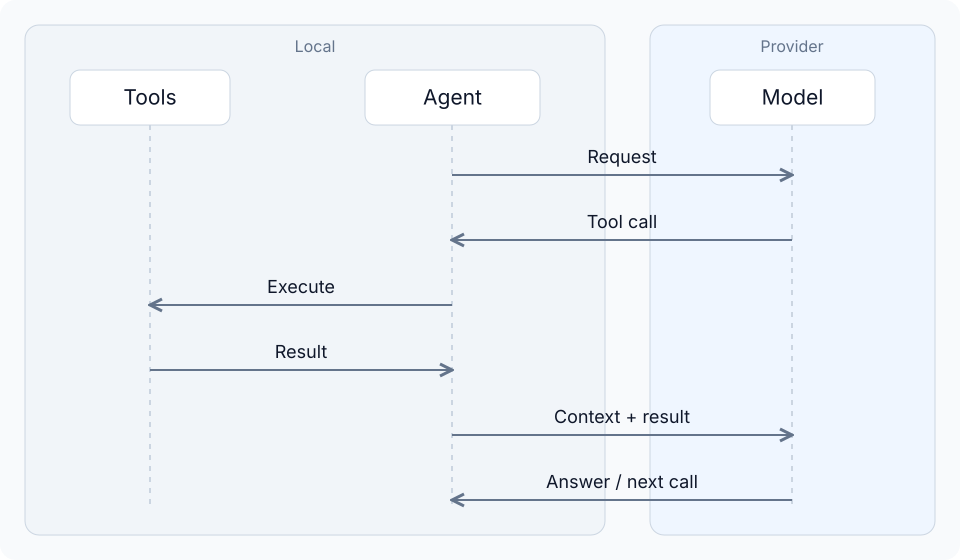

修复同名查询时，Agent 通常要经过几轮：

1. 搜索查询入口。
2. 读取相关函数。
3. 改掉提前返回的逻辑。
4. 运行测试。
5. 测试失败后，把报错带回上下文，继续判断和修改。

调用工具、取得结果、改变下一步，这个循环叫 **Agent 循环（Agent Loop）**。

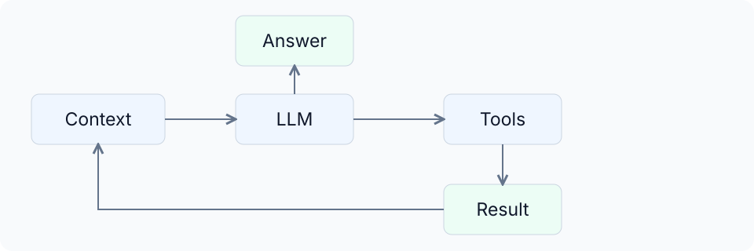

模型只负责生成下一步内容。真正把文件读取、命令执行、权限和循环连接起来的，还有一层运行环境，叫作 **Agent 运行框架（Harness）**。同一个模型换上不同工具和背景资料，完成效果可能完全不同。

[Pi](https://github.com/earendil-works/pi)把这几部分拆成可以对照阅读的代码。模型接口负责把消息发给模型服务并取回结果；Agent 核心保存对话、执行工具，再根据结果进入下一轮；外层编码工具把这些能力和界面连到项目文件。对照源码，就能看到 Harness 怎样把模型、工具和文件组织成一次任务。

作者 Mario Zechner 在 2025 年 11 月的文章 [What I learned building an opinionated and minimal coding agent](https://mariozechner.at/posts/2025-11-30-pi-coding-agent/)中解释了这些取舍。他最关心两件事：模型实际收到了什么，以及工具是否符合自己的工作方式。理解 Agent，既要看模型，也要看 Harness 怎样组织。

Pi 的 [Agent 核心文档](https://github.com/earendil-works/pi/blob/main/packages/agent/README.md)把这条路径写得很清楚：整理上下文，转换成模型接口接受的消息，调用模型；模型要求工具时，执行工具、记录结果，再进入下一轮。

发布流程这类工作，经常反复用到同一组说明、检查步骤和材料。把这类内容打包起来，让 Agent 在需要时加载，就形成了可复用技能（Skill）。Skill 必须符合项目实际；装得再多，工作流也不会自动变好。

### 多模态与计算机操作

有些任务不能只靠文字。检查软件界面需要看图，处理语音输入也离不开声音。能够同时处理文字、图像、音频等信息的模型，称为多模态模型。千问的 [Qwen2.5-VL](https://qwenlm.github.io/blog/qwen2.5-vl/)处理视觉与语言任务，[Qwen2.5-Omni](https://qwenlm.github.io/blog/qwen2.5-omni/)还能接收音频并输出语音。

有了视觉输入，Agent 可以先截图看软件界面，再调用点击、输入和滚动工具，取得新截图继续判断。这种能力叫计算机操作（Computer Use）。

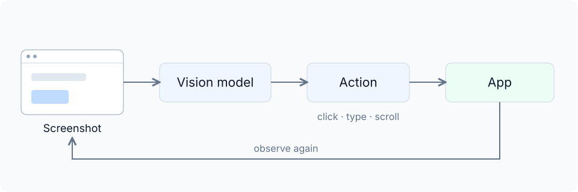

例如，检查成绩查询页面时，Agent 可以输入姓名、点击查询、观察结果。点击成功不等于查询正确，页面内容还要检查。已经有稳定 API 或命令行工具时，直接调用通常更简单。

模型会继续变强，工具接口也会不断更新。目标是否明确，背景是否充分，结果是否验证，始终决定一次任务能否真正完成。

## 上下文、生成速度与缓存成本

Agent 修一个问题，往往要反复读代码、调用模型、执行工具。任务越做越长，界面就会冒出上下文占用、Token 用量、生成速率和上下文压缩提示。这些数字分别对应容量、速度和成本。

### 上下文：模型这一次依据什么工作

模型每次回答，只能参考这次请求实际送进去的材料。这些材料共同构成 **上下文**。写代码时，Agent 的上下文通常包括任务要求、项目规则、保留的对话、工具说明、源码和工具返回结果。模型根据这些内容决定下一步。[上下文窗口文档](https://platform.claude.com/docs/en/build-with-claude/context-windows)列出了这些组成部分。

例如，设备通过串口通信时突然丢数据，最初的输入可能只有这一句故障描述。Agent 接着读取负责串口收发的代码，源码就进入上下文；再从串口取得设备的运行日志，日志也进入上下文。串口是设备与外部交换数据的常见接口。之后的判断同时依据问题、代码和现场现象。如果原理图只躺在磁盘里，没有被读取，也没有被作为输入提供，它就不在这轮判断里。

因此，文件在项目里、曾在聊天中出现、现在仍在模型上下文里，是三件事。聊天界面能保留完整记录，Harness 却可能只把其中一部分发给模型。

训练得到的知识、当前上下文和磁盘资料也不一样。训练形成一般能力，上下文提供当前情况，文件和历史记录则需要用时重新读取。Agent 所谓的“记忆”，通常就是重新加载这些资料。

### Agent 怎样组织一次模型请求

模型不会读取聊天界面里的所有内容。每次请求前，Harness 都要收集当前任务、保留的历史、项目规则和可用工具，再决定加载哪些资料。这些内容决定模型这一轮能看到什么，也决定输入要处理多少 Token。

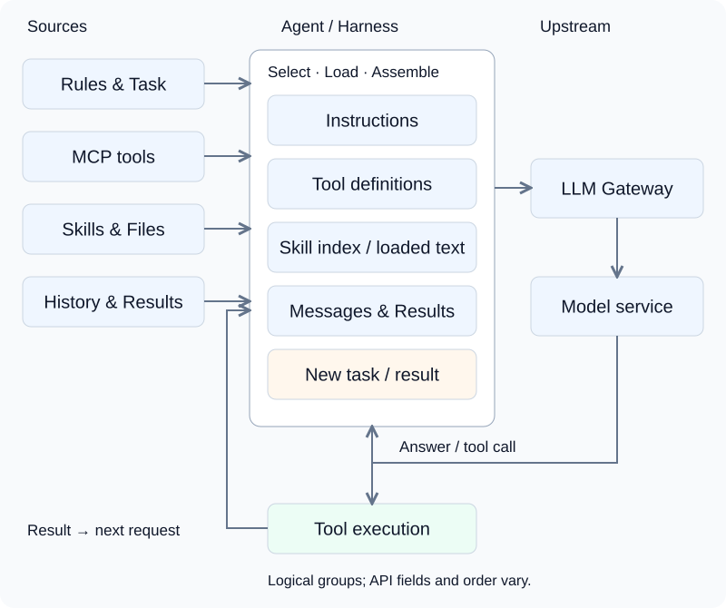

一轮请求通常由几部分组成：

- **指令（Instructions）**：系统要求、开发者指令和项目规则。
- **工具定义（Tool definitions）**：工具的用途和参数格式。
- **消息（Messages）**：用户要求、模型回答、工具调用和工具结果。

不同 API 的字段和顺序不一样，模型服务最后会把它们转换成实际处理的输入。

以串口故障排查为例，规则可以要求“保留现有通信协议”，工具定义可以告诉模型 `read_file` 接收文件路径、`run_command` 接收命令。串口收发代码、编译错误和串口日志则是工具结果。通信协议是两端约定怎样组织消息、按什么顺序收发的规则。工具定义说明能做什么，工具结果说明已经得到什么，两部分都会占上下文。

Agent 要使用项目管理、搜索或团队内部服务时，不必把每项能力都写进自己的代码。这些能力可以通过模型上下文协议（Model Context Protocol，MCP）接入。MCP 规定了一套通用方式，让应用发现服务公开的工具、取得参数说明并提交调用。Agent 先取得工具列表，再把选中的工具定义放进发往模型的 API 请求。模型要求调用工具后，Agent 才把请求交给对应的 MCP 服务，并整理返回值供下一轮使用。[MCP 工具规范](https://modelcontextprotocol.io/specification/2025-06-18/server/tools)分别说明了工具发现和调用。

所以，上下文里放的是 MCP 工具说明和返回内容，不是整套 MCP 服务。连接、认证和工具实现由运行 Agent 的应用负责。启用很多 MCP 服务时，大量工具定义可能占满窗口，也可能由 Agent 按需搜索。

Skill 采用渐进加载。[Agent Skills 规范](https://agentskills.io/specification)先向模型提供名称和简介；决定使用后，再加载 `SKILL.md` 正文，需要时继续读取配套资料。图中的“Skill 索引”表示简介列表，“已加载文本”（loaded text）表示正文。装上一个 Skill，不会自动把它的所有文件塞进每轮上下文。

整理好的请求随后发往上游。有些系统中间有大语言模型网关（LLM Gateway），负责认证、模型路由和格式转换；有些应用直接调用厂商接口。上下文由 Harness 组织，网关还可能继续转换或补充。换模型或换到缓存不共享的实例后，键值缓存（KV Cache）也可能无法继续复用。

### 上下文窗口：一次能容纳多少内容

任务越长，规则、对话、源码和结果都会不断追加。一次调用能容纳的 Token 有上限，这个上限叫 **上下文窗口**。它限制这轮计算，不是账号能保存多少聊天记录。常见模型的输入和输出共用窗口，推理模型还会产生不直接显示的推理 Token。最大输出长度另有限制，窗口多大不等于回答就能多长。[OpenAI 的上下文说明](https://developers.openai.com/api/docs/guides/conversation-state)解释了两者的区别。

窗口为 128,000 Token，当前输入占了 100,000，就只剩约 28,000。模型即使允许更长输出，也不能越过这段空间。真实 Agent 还要给后续生成和工具结果留位置，所以界面显示的可用容量常常小于标称值。

窗口里的内容远不止手输的几句话。读一次长日志、返回大量搜索结果，都会明显增加占用。上一轮生成了 2,000 Token 的解释，如果下一轮继续保留，它又会成为新的输入。任务连续执行，历史、工具调用和结果自然越积越多。

窗口占用和累计用量不是一回事。前者是当前装了多少，后者是多次调用一共处理了多少。三次输入分别是 10,000、12,000、15,000 Token，累计就是 37,000，最后一次窗口里却只有 15,000。

窗口大不代表资料越多越好。两份互相冲突的接口说明完全放得下，模型仍会难以判断。窗口解决容量，材料是否相关、是否可靠，属于上下文工程。

### Token 速率：等待发生在哪一步

界面里的 `tokens/s` 或 `tok/s` 表示每秒处理或生成多少 Token。问“出字快不快”时，通常指输出生成速率。按每秒 50 Token 估算，生成 1,000 Token 要约 20 秒。单位是 Token，不是汉字。

一次请求大致有两段计算。先处理输入，叫预填充（Prefill）；再逐个生成新 Token，叫解码（Decode）。输入能够批量算，输出要依赖刚生成的 Token，所以两段速度不能混着比。

请求发出后，到收到第一个 Token 之前的等待，叫首 Token 延迟（Time to First Token，TTFT）。这段时间可能花在网络传输、排队、处理输入和不直接展示的推理上。所以模型可能迟迟没有输出，一旦开始生成却又很快。

Agent 的总耗时更长。读文件、编译、烧录（把程序写入设备）、等待设备返回，都不在模型的输出时间里。一个任务可能有多次模型调用和工具执行，所以输出速率翻倍，任务时间未必减半。

模型服务还会限制每分钟能够处理的 Token 数（Tokens Per Minute，TPM）。达到限制后，请求可能等待或重试。TPM 表示吞吐上限，不代表单次回答有多快。

### 上下文压缩：任务怎样继续

任务越做越久，窗口迟早会接近上限。全部历史都留着，后面的工具结果就没有地方放。此时需要用更少的 Token 保留后续任务仍然需要的信息，再继续调用模型。这个整理过程叫上下文压缩（Compaction）。

最简单的做法，是把早先的讨论整理成摘要。排查通信故障时，后面真正需要的也许只是接线结论、复现条件、排除过的原因、当前修改和未完成的验证。留下这些，就不必每次都带着整段排查过程。

有些服务还会返回一段模型能够继续使用、但人读不懂的压缩状态，例如 [OpenAI 的 Compaction 接口](https://developers.openai.com/api/docs/guides/compaction)。形式不同，目的相同：减少当前占用，让长任务继续。

压缩通常会丢掉一部分信息。如果只留下“串口代码已修改”，却漏了“还没有把程序烧录到开发板上验证”，下一阶段就可能误判进度。更危险的是，模型不会自动意识到某条信息已经丢失，可能用看似合理的内容补上空位，产生幻觉。关键要求、事实和未完成事项需要尽量留下。

被压掉的源码还能从文件重新读取，设计理由却未必能从代码里找回。压缩后继续工作，关键判断要回到源码、需求和验证记录核对。重要讨论留在议题、合并请求等可追溯记录中，正是为了让上下文可以压缩，工程依据仍然有出处。

压缩也要花时间。如果额外调用模型完成，还会产生用量。它用一次整理换后面更短的上下文，是否值得，要看整理成本、任务还剩多长，以及会不会丢掉关键信息。

### 键值缓存（KV Cache）：已经计算过的内容怎样复用

模型逐个生成 Token，生成后一个时还要参考前面的内容。第 100 个 Token 处理过的历史，到第 101 个时大部分仍会用上。每一步都重新计算，只会重复劳动。

**键值缓存（Key-Value Cache，KV Cache）**保存模型已经算过的中间结果。生成后续 Token 时，复用这些结果，只处理新增加的部分。它缓存的是计算状态，不是一段现成答案。[Hugging Face 的说明](https://huggingface.co/docs/transformers/en/cache_explanation)展示了这个过程。

所以，缓存命中不等于复制上一轮回答。新问题还要算，新回答还要生成。省下的是重复处理旧内容的那部分工作。

缓存也有资源成本。它要占存储空间，序列越长通常占用越多，服务器必须管理容量和保留时间。

### 提示词缓存（Prompt Cache）：多次调用怎样少做重复计算

KV Cache 解释的是一次生成内部的复用。服务端如果继续保留这些状态，下一次请求又带着相同开头，就能跨请求复用。**提示词缓存（Prompt Cache）**常靠这些状态减少重复输入的计算。

复用的是输入前缀经过模型计算后形成的状态。原始文本仍然参与当前任务。服务端找到可用状态，就跳过一部分 Prefill，再处理后面的输入和生成。上一轮回答如果进入下一轮历史，也可能成为前缀的一部分。

这里的“开头”叫前缀。它必须从输入起点开始，顺序一致，并不只是中间出现了几个相同关键词。例如，两次请求都用相同的项目规则和资料开头，只在末尾换问题，共同前缀才有机会复用。开头的规则一改，后面即使再次出现同一份资料，也不能直接假定整段缓存还能命中。

DeepSeek 的[上下文缓存文档](https://api-docs.deepseek.com/zh-cn/guides/kv_cache/)给了多轮对话的例子。放进编程任务看，第一次请求可以带上项目规则和一段串口接收代码，要求解释代码。接收代码会把到达的字节放进缓冲区，也就是一小块临时保存尚未处理数据的内存区域。第二次保留这些内容和上一轮回答，再追问“接收缓冲区满了以后，这段代码会怎样处理？”。

第二次请求时，如果缓存已经建立并且仍然可用，共同前缀就会命中。服务端只处理追加的问题，再生成新回答。DeepSeek 默认开启这项功能，但第二个问题的答案仍要重新算。

缓存没有把内容从窗口删掉。它们仍在这次任务里，只是部分计算得到复用。压缩改变保留多少信息，缓存改变重复计算多少信息，所以“缓存命中率很高”和“上下文快满了”可以同时发生。

### 上下文的组织怎样影响缓存

Prompt Cache 匹配模型服务实际收到的输入前缀。项目规则、工具定义、Skill 索引、已经加载的正文和对话历史，只要进入前缀，都可能参与匹配。它不只缓存用户手写的一句 Prompt，也不会因为内容叫“系统提示词”就自动命中。

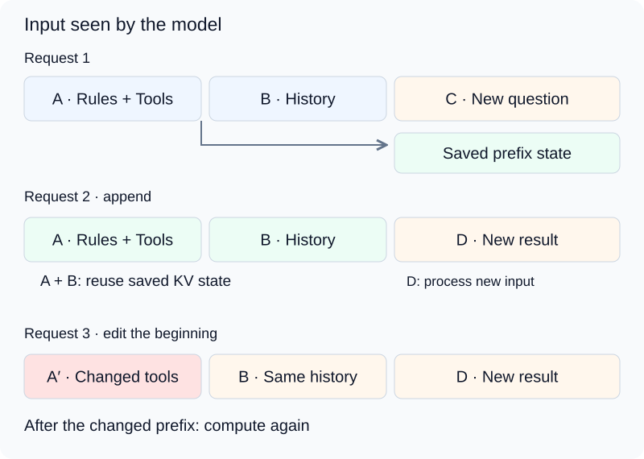

图中 A 是规则和工具定义，B 是保留的历史。继续保留 A、B，只在末尾追加 D，就有机会复用前面一段；如果把开头的 A 改成 A′，B 的文字虽然相同，前面的内容已经变了，整段就要从变化位置重新处理。

对 Agent 来说，前缀变化很具体。每轮改写项目规则、重新排列工具定义，或者把当前时间放在最前面，都可能缩短共同前缀。新 MCP 工具改变前部工具列表，也可能让后面历史失去原来的缓存。按需加载 Skill 时，正文追加在末尾，已有前缀容易保持；如果 Harness 把正文插进开头，后面的内容就要重新计算。

组织上下文时，可以固定长期有效的规则和工具定义，把当前任务的新材料放在后面。内容和顺序保持一致，复用机会才更多。规则确实改变、资料已经过期时，仍要及时更新，不能为了命中缓存继续用错误信息。

压缩也会改变结构。一段历史换成摘要，Token 序列已经不同；前部规则可能还能复用，替换位置后的部分却要重建缓存。上下文变短，不代表这次输入处理一定更便宜。

### 缓存的有效期与费用

缓存占存储，不能保证一直在。缓存存活时间（Time to Live，TTL）表示服务准备把缓存保留多久。DeepSeek 文档说明，不再使用的缓存通常会在数小时到数天内清理。这里说的是服务何时回收，不是模型能记住一件事多久。

隔一段时间再讨论串口代码，原来的缓存可能已经没了。只要 Agent 仍把代码和历史放进请求，模型就能依据这些内容回答，只是服务端要重新计算。缓存失效和聊天记录丢失是两件事。

费用也可以沿用这个例子。DeepSeek API 返回 `prompt_cache_hit_tokens` 和 `prompt_cache_miss_tokens`，分别表示命中与未命中的输入 Token。两者都在一次请求的输入里，生成的回答另算输出 Token。

假设第二次请求包含 21,000 个输入 Token，其中 20,000 个命中了缓存，另外 1,000 个没有命中，最终生成了 800 个输出 Token。这次调用的费用就由三部分组成：

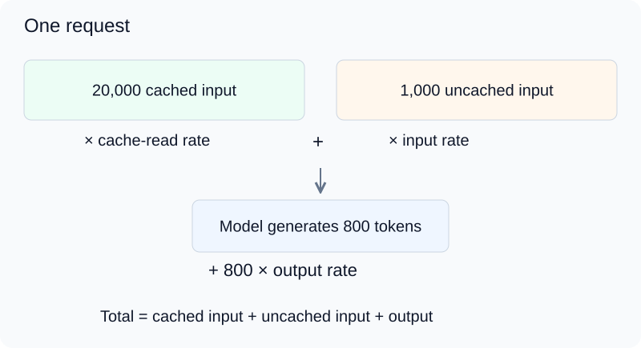

- 20,000 个命中缓存的输入 Token。
- 1,000 个未命中缓存的输入 Token。
- 800 个新生成的输出 Token。

把三部分分别乘以单价，再相加，就是这次调用的费用。单价如果按每百万 Token 标注，数量也要先除以一百万。缓存只降低重复输入的费用，新问题和新回答仍要付钱，所以输入便宜九成，不代表整个任务便宜九成。

假设三档单价分别是每百万 Token 0.1 元、1 元和 2 元，这次费用就是 0.002 + 0.001 + 0.0016 = 0.0046 元。同样输入如果完全没命中，则是 0.021 + 0.0016 = 0.0226 元。

缓存读取更便宜，但材料仍占上下文，新问题和新回答也仍要计费。连续围绕同一份资料工作，复用机会更多；缓存被清理、公共内容变化或产生额外写入费用时，最终账单也会不同。

缓存优化也不等于一直往上下文里堆材料。用不到的内容即使命中，仍占窗口、产生读取费用，还可能干扰判断。固定规则和公共资料保持稳定，在后面追加当前任务，更有利于复用。

## Agent 结对编程：工程协作为什么仍然重要

模型能生成代码，Harness 又能让它读取项目、执行修改和运行测试，开发者不必亲手完成每一步。一个人因此有机会承担过去做不完的工作，协作问题也会更早暴露出来。

结对编程原本指两名开发者围绕同一次修改持续合作。一人编写时，另一人阅读代码、考虑边界并检查结果，两项工作可以轮换。这样做的价值在于尽早发现问题，让写代码的人不只顺着自己的思路往下走。

把其中一方换成 Agent 后，合作形式变了，检查结果的责任没有消失。开发者说明目标和限制，Agent 读取项目、修改并测试；生成的修改还要回到共同检查中。这里的“结对”不必要求双方同时坐在电脑前，也不必一直由人敲代码。真正需要保持的是双方对任务、依据和交付结果有同一套认识。即使项目只有一名开发者，也要想清楚 Agent 依据什么作决定。

Agent 结对编程可以借用软件工程积累下来的经验。需求分析、架构设计、版本管理和代码审查（Code Review）本来就在解决协作问题。它们不能被压缩成一串让 Agent 执行的流程名称。

模型能力和工程问题也要分开。某代模型看不懂原理图、读不完大仓库，可能过几个月就改善了。项目到底要解决什么，哪些功能不必做，最后交付什么，不会随着模型变强自动有答案。

工作方法建立在“模型永远做不好某件事”上，很快就可能过时。真正值得积累的，是怎样利用不断增强的能力做工程，以及怎样处理剩下的复杂度和责任。

## 提示词工程：避免许愿式编程

人把自己的目标写进对话，模型据此读文件、改代码。提交给模型的要求和指令叫提示词（Prompt）。怎样把目标、限制和材料表达清楚，是提示词工程要处理的问题。放到实际项目里，它首先反映开发者是否想清楚要交付什么、有哪些限制、哪些选择已经确定、哪些还要讨论。

自然语言提要求很方便，也容易让人产生错觉：只要把想要的结果说出来，后面的都归模型管。“做一个稳定可靠的成绩管理系统”听起来像需求，实际上没有说明这里的“稳定可靠”是什么。

如果不继续讨论，文件怎样保存、同名怎样处理、异常后能不能恢复，就全交给 Agent 自己决定。代码可能很快生成，界面也可能像模像样，但这些决定未必是项目真正需要的。

这就是许愿式编程。开发者给了一个愿望，没有形成明确需求，也没有建立检查结果的依据。最后接受的只是模型补出来的一套设想。

### 需求定义与方案 Review

避免许愿，就要把模糊期待改成能讨论的工程要求。兼容哪些旧文件、同名记录返回几条、输入错误时会不会改旧数据，这些都是需求。

这些内容不必由开发者一开始全部想完。Agent 可以读项目、找遗漏、比较方案。结对编程的意义是一起把问题想清楚，不是等某个人一次写出完美 Prompt。

讨论出来的方案仍要判断。新增功能是真需要，还是因为别的项目都有？改保存格式是旧格式真的不够用，还是新格式写起来更省事？这些决定会影响产品，不能被埋进自动生成的代码。

方案 Review 是在编写大量代码之前，检查目标、边界和方案取舍是否成立。它的价值也在这里。几千行代码已经生成，再回头猜模型做过哪些决定，成本很高。先看目标和接口，在更容易理解的位置确认方向；到代码审查阶段，再检查实现有没有兑现。

表达问题没有固定模板。对话、短说明、图示、已有代码都能讲清意图，关键是双方能围绕同一组目标和约束作判断。

### 实践经验与许愿的区别

工程判断靠经验，没有一套固定方法能推出唯一答案。调试、试验、比较方案，都能帮助理解问题。一次实践有价值，是因为它增加了事实、解释了现象，或者改变了原来的判断。

许愿省掉了这些过程。遇到错误只说“继续修好”，拿到实现只问“这次能不能跑”。需求一直模糊，修改影响也没人检查。

反对许愿并不排斥实践。工程判断不能寄托在模型不断生成后的偶然结果上。实践应该让人越来越理解项目，不能让代码越来越多，理解还停在“这次好像能用了”。

嵌入式开发尤其如此。程序直接控制硬件，错误可能变成一个真实动作，而不只是终端里的一行输出。

“让电机按指令转动”只是一个目标。上电时能不能转，没有新指令时停还是保持，通信恢复后是否继续，都要另外定义。没有定义，实现者只能自己补，电机在正常输入下能转，也不说明这些选择正确。

实施前要知道技术方向，也要知道什么行为不能接受。Agent 可以补问题、比方案，开发者仍要理解这些决定怎样落到代码里。功能验收看设备是否按要求工作，代码 Review 看实现方式依赖了哪些条件，一次演示成功覆盖不了后者。

## 软件复杂度管理：为什么需要 Less is More

需求讨论清楚以后，还有另一个问题：Agent 提出的功能和设计，是否真的都要留下。

过去，多做一个功能要花不少编码时间。想法再多，成本也会逼着项目取舍。Agent 把写代码变便宜以后，一句话就能生成一套实现，原本会被放弃的附加功能很容易混进项目。

但代码生成以后还要整合进同一个项目、验证和维护。多一种文件格式，就多一套读写行为要保持正确；多一个配置项，就多一种运行条件要考虑。写代码变快了，后面这些工作不会一起消失。

成绩工具本来只需读固定文件。为了“以后可能有用”，又加入数据库（专门保存和查询数据的软件）、多种文件格式和额外的扩展功能，字段一改，所有路径都要同步。功能还没派上用场，维护成本已经来了。

代码越容易生成，越要主动决定什么不做。少即是多（Less is More）在这里很具体：少承担没必要背的功能和设计，把精力放在真正要交付的部分。

### 功能克制与设计克制

功能克制，是问“这个功能要不要做”。当前只按完整姓名查询，就没必要因为 Agent 写得出来，再塞进模糊匹配、拼音搜索和复杂排序。真出现需求时再判断。

设计克制，是问“要做到多复杂”。同一个查询，可以直接遍历记录，也可以建立索引（为加快查找而额外维护的数据结构），或者采用更通用的查询框架。数据规模、性能要求和维护方式不同，合适方案也不同。

Less is More 不能按代码行数算。错误处理和测试会增加代码，却能减少数据损坏和回归；大量包装层会让函数变短，读一次查询却要跳好几个文件。

先看功能。只因为“以后可能会用”就提前增加实现，会把当前的验证和维护成本一起留下。“用不到时再实现”（You Aren't Gonna Need It，YAGNI）反对的正是这种提前承诺。[Martin Fowler 的 YAGNI 文章](https://martinfowler.com/bliki/Yagni.html)讨论了提前实现的代价。

再看设计。完成同一项功能时，能直接表达清楚的结构就不额外增加层级，也只有在这种情况下，“保持简单”（Keep It Simple, Stupid，KISS）才真正有助于控制复杂度。简单不等于代码少，判断标准仍是当前问题能否被清楚、可靠地解决。

没有公式能判断所有设计。经验真正有用的地方，是分清复杂度来自需求、来自当前实现，还是根本没必要承担。

### “不要重复自己”（DRY）为什么也需要判断

复杂度还来自同一条规则写在多个地方。成绩有效范围在导入、录入、修改里各写一遍，以后改规则就要改三处，漏一处就不一致。

把规则集中到一个维护位置，不同入口就能用同一套判断，人和 Agent 也更容易找到修改处。避免同一份知识被反复编写和维护，通常称作“不要重复自己”（Don't Repeat Yourself，DRY）。

两段代码看起来相似，不等于表达同一份知识。查询学生和查询课程都可能遍历数组，后面的规则却不同。为了消灭循环上的重复，把它们塞进一个满是开关的通用函数，两种变化反而会互相牵扯。

DRY 和保持简单要一起看。抽象合适，能藏住共同复杂度；抽象不合适，只是把不同问题绑在一起。tison 在[《Agentic Coding 的边界》](https://www.tisonkun.org/2026/04/18/agentic-coding-boundary/)中讨论的过度抽象，就是这个意思。

Agent 很快就能抽函数、拆模块。能重构不等于这次重构有价值，人还要判断这些结构到底减轻了什么。

## 上下文工程：架构也是信息的组织方式

复杂度不只影响以后维护，也影响 Agent 现在能不能理解项目。

模型每次只看到输入里的上下文。项目越大、依赖越多，一次修改要同时懂的东西越多。查询、文件读取和显示混在一起，改一个查询条件，就得顺着整条数据流读。

清楚的结构能减少这份负担。读取模块生成记录，查询模块筛选，显示模块输出。接口约定清楚，理解查询时就不必把所有文件格式都翻一遍。

目录决定文件放在哪里，接口约定模块怎样互相使用，依赖记录一个模块又用到哪些其他模块。这三者共同决定理解一项任务要穿过多少无关内容。这种做法不只是在对话里多放几个文件，还把项目结构看作信息组织方式，叫上下文工程（Context Engineering）。项目结构因此同时影响人和 Agent 每轮需要读取什么，这是软件设计与上下文工程之间的直接联系。

### 项目规模与外部上下文

大型纯软件项目常有很多历史实现、兼容层和依赖。模型即使能读很长，怎样找到入口、弄清影响范围，仍然影响效率。用架构控制信息之间的关系，比不断堆说明更有长期价值。

典型的裸机嵌入式项目可能小得多。这里的裸机表示程序直接运行在芯片上，不经过桌面操作系统。项目通常围绕一块确定的电路板、几种外设（与芯片连接并由程序控制的其他硬件）和一组功能展开，不必背着大型通用软件的历史包袱。和 Linux、Chromium 这样的大项目相比，Agent 要同时掌握的代码少得多。

前提是上下文充分。源码能说明程序操作了哪个引脚，却不说明引脚接了什么。原理图记录连接，芯片手册说明硬件功能和使用条件，项目配置决定时钟和外设怎样工作。这些资料和代码放在一起，才够理解设备。

同样一句设置输出电平的代码，在不同电路里可能对应不同动作。只给函数名和源码，让 Agent 猜外部连接，判断出错很正常。把实际连接和工作要求给出来，讨论才有事实基础。模型能不能看懂图，是模型能力；项目有没有提供正确的图，是上下文组织。

读懂工程以后，还要看实际运行。代码写的是打算怎样操作硬件，设备是否照做，要观察结果。某个等待会不会拖住别的任务，某个异常会不会让设备停住，不能因为“仓库已经读完”就有答案。

所以，代码量小只降低理解成本，不会降低稳定性要求。对这类项目，工作重点会更早落到实现是否可靠、开发者是否理解关键行为、测试是否充分。模型再强，也要继续回答这些问题。

### 工程知识需要有可靠的来源

项目里如果有三份互相冲突的接口说明，上下文再多也不会自动确定。模型还得判断哪份有效，维护者自己可能都没统一。

工程知识也要少重复。当前行为由实现和必要文档表达，重要约束有明确位置，历史取舍能追到当时的讨论。人和 Agent 才能依据同一套事实继续开发。

Git 记录版本和差异，GitHub 上的议题（Issue）保存问题，合并请求（Pull Request，PR）把修改、讨论和代码审查放在一起。时间、状态和关联版本让一条结论能回到当时的情境，而不是脱离背景漂浮。

这比不断生成没有时间背景的总结有用。为兼容旧格式采用的办法，可能后来已经被换掉；只留一句“项目使用某种格式”，很容易把旧决定当成当前规则。

文档仍然要写，但用途得明确。用户需要安装和使用说明，维护者需要理解设计理由与约束。机械复述源码、复制同一份任务记录，只会多出一套必须同步的内容。

Skill、项目规则和记忆机制也在处理这些信息。它们能减少重复交代，同样会重复、会过时。工具越多，越要回到实际用途，判断值不值得放进工作流。

## Git 与 GitHub：把修改组织成可审查的工作

### 为什么需要版本管理

程序刚写时也许只有几个文件，改完直接保存就够了。项目一大，麻烦很快出现：昨天还能收数据，今天改几处就开始丢帧；旧功能还在用，新功能也得开发；两个人改了同一个文件，合并时不知道留哪边。

把目录复制成“旧版”“新版”“最终版”，能留下副本，却说不清两版改了什么、为什么改、哪版验证过。Agent 一次动多个文件时更麻烦，只看最后能不能运行，很容易漏掉顺带发生的变化。

这些副本还回答不了几个关键问题：两版之间改了什么，哪一版经过验证，出问题时该回到哪里。为了把这些变化连贯地记录下来，需要使用版本管理。Git 会把某一刻的项目状态保存成一次提交（Commit）。提交有标识、说明和前后关系，可以比较差异，也能取回旧文件。保存提交和分支关系的地方叫仓库（Repository）。

串口收发代码通过一轮验证后，代码、测试和配置可以记录成一次提交。之后新增功能出了故障，就能比较新旧版本，缩小排查范围；需要恢复时也有明确位置。Git 不判断版本是否正确，测试结果和提交说明仍要如实记录，只是让“之前那个能用的版本”变得找得到。

还没准备合回稳定版本的修改，可以放到一条单独开发线。这条线叫分支（Branch），既能保住稳定版本，又能继续做事。完成后检查差异、跑验证，再通过合并（Merge）带回共同版本。一条修改因此有了明确的起点和终点。

GitHub 托管 Git 仓库，也提供协作功能。本地提交推送上去，其他人才能取得；Issue 保存问题和需求，PR 提出一组修改，集中讨论、审查并决定是否合并。Git 在本地也能用，GitHub 把版本和团队协作接在一起。

版本管理的理由很具体：前后能比较，故障能追溯，工作能分开，发布结果能对应确定版本。后面要约定的就是一次提交放什么、任务在哪条分支做、满足什么条件才合并，这些约定组成工作流。

### 常用操作在流程中的位置

Git 命令为常见操作提供统一名称，不同工具底层做的也是这些事。日常操作可以交给 Agent，也可以在编辑器或图形客户端里点出来。命令要学到“什么时候用、会改什么、做完怎样查”，具体参数用时再查。

编辑器里正在改的文件属于工作区。准备留下一条历史记录时，先看它们与上一版之间的差异（Diff），再从这些修改里挑选本次要提交的内容。被挑中的内容先进入暂存区（Staging Area），最后写说明并提交。这样可以把相关改动放在一起，避免另一项未完成的工作混进同一条记录。

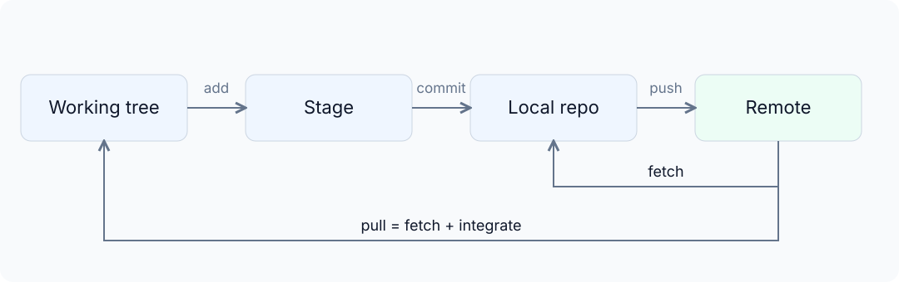

| 目的 | 常用 Git 命令 | 工作时关注什么 |
| --- | --- | --- |
| 取得项目 | `git clone` | 将远程仓库取到本地，确认来源与当前分支 |
| 检查修改 | `git status`、`git diff` | 修改范围，以及是否混入无关内容 |
| 开始一项任务 | `git switch -c` | 从约定的基础版本创建工作分支 |
| 组织并保存版本 | `git add`、`git commit` | 暂存内容是否构成一项完整修改 |
| 取得远程进展 | `git fetch`、`git pull` | `git fetch` 获取远程记录；`git pull` 还会将进展整合到当前分支 |
| 共享本地提交 | `git push` | 将准备共享的提交上传到远程仓库 |
| 合并开发成果 | `git merge` | 双方修改是否经过审查和验证；团队协作中通常通过 PR 接受修改 |
| 查看历史 | `git log`、`git show` | 查找具体提交，理解修改内容与前后关系 |
| 撤销已提交修改 | `git revert` | 用新的反向提交保留恢复记录 |
| 标记发布 | `git tag` | 为确定提交命名，关联发布产物 |

可以让 Agent 检查改动，只暂存串口修复相关文件，再准备提交说明。`add` 和 `commit` 可以委托，但仍要确认它没夹带另一项功能。Agent 说“已提交”，只是本地记录完成，不等于推送、PR 通过或版本已发布。

安装、参数和冲突操作可以查 [Pro Git 的 Git 基础](https://git-scm.com/book/en/v2/Git-Basics-Getting-a-Git-Repository)与[分支章节](https://git-scm.com/book/en/v2/Git-Branching-Branches-in-a-Nutshell)。日常最该养成的是顺序：先看状态和差异，再决定暂存、提交或合并。Agent 写了总结，实际 Diff 仍要检查。

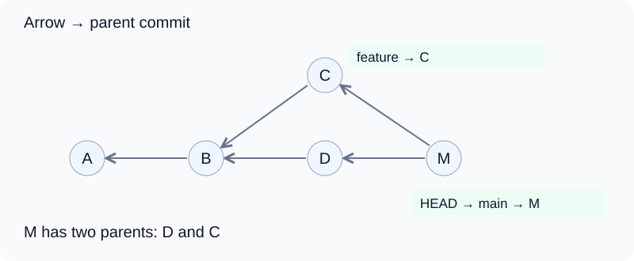

Git Graph 用圆点表示提交，用连线表示父子关系。图中箭头指向父提交，M 连接 D 和 C 两条历史。分支名指向某个提交，`HEAD -> main` 表示当前在 `main` 分支。先找当前位置，再看目标分支和共同祖先，就能判断两边只是快慢不同，还是各自加了修改。颜色只是辅助，未提交的编辑还要看更改列表或 `git status`。

### 提交说明（Commit Message）：让历史能够被理解

一次提交只围绕一个目的，把相关的代码、测试和说明放在一起。修复串口解析越界时，回归测试可以一起提交，后来的人才看得懂、验得了。如果同时格式化全项目，再夹带一个功能，审查、定位和撤销都会变难。

提交一多，如果标题只凭个人习惯来写，维护者和自动化工具都很难快速判断每条记录属于哪类修改。前端框架 Angular 的团队整理过一套提交消息格式，后来演变成今天常用的[约定式提交（Conventional Commits）](https://www.conventionalcommits.org/zh-hans/v1.0.0/)。这套约定让人和自动工具都能看出这次修改想做什么：

~~~text
<type>[可选的 scope][可选的 !]: <简短说明>

可选正文

可选页脚
~~~

`type` 表示修改类型，`scope` 表示模块。`feat` 通常用于新增功能，`fix` 用于修复；项目还可以约定 `docs`、`test`、`refactor`、`ci`。标题要写具体变化，不要只写 `update` 或“修改完成”：

~~~text
fix(uart): reject frames with invalid lengths
feat(query): return all records with the same name
test(parser): cover incomplete frames
ci: build firmware on pull requests
~~~

标题放不下的原因和约束写进正文。例如，为什么必须保留旧协议，为什么更简单的修法不可行。关联问题可以写 `Refs: #42`。不兼容变更要用 `!` 或 `BREAKING CHANGE:` 标清，并说明调用方怎样迁移：

~~~text
feat(protocol)!: add a length field to frames

BREAKING CHANGE: receivers must parse the new length field.
~~~

规范能让历史更容易读懂，也为发布说明和版本工具提供依据。写了 `fix:` 却仍然含糊，问题不会消失；规范本身也不会代替发版。合并 PR 时，可以将分支上的多条提交压缩成一条，这种操作叫压缩合并（Squash）。压缩合并时要检查最后保留下来的提交说明，逐条保留提交时则要整理分支里的每一条。合并方式和消息规范应当配套。

### 分支工作流（Gitflow）：分支为什么需要分工

日常开发、发布准备和紧急修复如果全挤在同一条开发线上，尚未完成的功能很容易混进待发布版本。Vincent Driessen 在 2010 年整理出一套用不同分支隔离这些工作的[分支流程](https://nvie.com/posts/a-successful-git-branching-model/)，后来通常称为 Gitflow。它适合有明确版本阶段的项目。

| 分支 | 职责与流向 |
| --- | --- |
| `main` | 保存正式发布的历史，并用版本标签（Tag）标记版本 |
| `develop` | 集成下一版本的开发成果 |
| `feature/*` | 从 `develop` 开始，完成单项工作后合回 `develop` |
| `release/*` | 从 `develop` 切出，稳定待发布版本；完成后合入 `main`，并将修复带回 `develop` |
| `hotfix/*` | 从已发布的 `main` 修复紧急问题，再将修复带回开发线；存在发布分支时也要同步处理 |

嵌入式设备上直接控制硬件、随设备一起运行的程序通常叫固件。下一版固件正在增加功能，已发布版本却出现了通信故障。把所有开发代码一起发出去，没验证的功能也会跟着进入修复。Gitflow 用不同分支把两条工作分开：修复从已发布版本出发，完成后同步回开发线，下一版才不会重新踩坑。

固件交付还要把 Tag、目标硬件、编译配置和测试结果对上。只有一个改名成“最终版”的固件文件，很难知道它来自哪次修改，也无法可靠重建。

Gitflow 分支多，维护成本也高。作者在 2020 年的补充说明里建议，持续交付项目可以用更简单流程。小型课程项目可以采用 [GitHub Flow](https://docs.github.com/en/get-started/using-github/github-flow)：从主分支拉短期分支，通过 PR 检查和合并。需要固定发布阶段或并行维护版本时，再上 Gitflow。最佳实践是边界清楚，不是分支越多越好。

### 议题、合并请求与持续集成/持续部署（CI/CD）怎样连起来

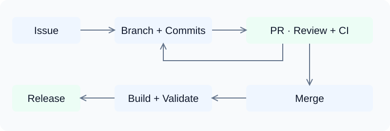

一次完整的协作通常按下面的顺序进行：

1. **Issue**：写清现象、软硬件版本、复现条件、预期和待讨论的方案。
2. **工作分支与 Commit**：从约定的基础分支开始修改、测试并提交。Gitflow 的日常开发一般面向 `develop`，简单流程通常面向 `main`。
3. **Pull Request**：写清解决什么问题、改了哪里、验证了什么、还有哪些待确认，并关联 Issue。每个仓库通常有一个默认分支，GitHub 上常见的是 `main`。`Closes #42` 能否自动关闭 Issue，取决于 PR 最终是否合入默认分支。
4. **持续集成（Continuous Integration，CI）**：代码发生变化时，由服务自动运行预先约定的检查。GitHub 提供的 GitHub Actions 可以在 PR 更新后运行编译、测试和静态检查。静态检查不执行程序，直接从源码中寻找类型、格式或规则方面的问题。配置放在 `.github/workflows/`。
5. **Review 与合并**：人工 Review 判断实现是否符合需求、有没有引入不必要复杂度；自动检查负责既定测试是否通过。分支保护或规则集是仓库设置的合并门槛，可以要求检查通过并获得人工批准。
6. **持续交付和持续部署（Continuous Delivery / Continuous Deployment，CD）**：持续交付生成可以交付给用户的文件，例如安装包或固件；持续部署继续把版本送到服务器或设备等运行环境。嵌入式项目可以自动构建固件和验证报告，烧录到设备仍要考虑目标硬件、发布批准和失败恢复。

Agent 生成代码只是其中一步。任务能否完成，要看 Issue、分支、Commit、PR、CI 和发布记录能否说明修改为什么成立、怎样验证、最终接受了哪一版。[GitHub Actions 文档](https://docs.github.com/en/actions/get-started/understand-github-actions)给出了具体配置方法。

## 交付边界：工程责任怎样落实

上下文充分、结构清楚，能让协作更顺畅，但最终还要回答一个问题：生成的结果凭什么可以交付。

Agent 能做很多事，却不能替开发者承担产品责任。代码由谁敲出，不会改变交付者必须兑现的承诺。所以，在讨论是否 Review、要理解到什么深度之前，先要确定交付对象。

### 应用、开发工具包（SDK）与接口（API）的不同承诺

交付一个成绩查询应用时，使用者只关心能不能查到成绩、数据对不对、出错后还能不能用。内部用数组还是索引，可以交给实现决定，但这些行为不能变。

如果交付对象换成其他开发者，情况就不同了。他们需要使用交付内容中的函数、数据结构和错误处理方式继续开发。为这种直接调用准备的一套库、接口和配套工具，通常叫软件开发工具包（Software Development Kit，SDK）。既然其他程序要依赖这些名字和调用规则，代码层面的设计本身也成了交付内容。

例如，返回的记录由谁释放、没有结果时怎样表示、升级后原来的调用还能不能用，都属于接口承诺。对这类产品，关注代码和接口不是个人偏好，而是交付形式带来的要求。

人对代码负责，不等于每行代码都要用同样的强度阅读。内部实现有充分的行为验证，可以少做一些逐行检查；接口、重要行为和设计取舍处在交付边界上，则需要直接理解和 Review。边界也不能只看文件放在哪里，内部逻辑一旦会损坏使用者数据，同样要审查。

### 嵌入式交付为什么尤其需要审慎

前面讨论过，典型裸机项目的代码量可能并不大。Agent 能读完仓库，开发者也能掌握主要流程，但这些便利不代表“出了问题以后再修就行”。嵌入式交付还受设备所在位置、连接条件和当前运行状态限制。

开发时，电路板就在桌上，程序出错后可以重新烧录、复位，再观察结果。产品交付以后，设备可能已经装到现场，接不到开发者的电脑。这时要修复，除了改代码，还得想办法让新版本进入设备。

设备能联网时，可以通过空中更新（Over-the-Air，OTA）在不到现场的情况下更换固件。设备下载新版本，写入存储器，再按设计启动。更新路径本身也依赖软件和硬件正常工作。

如果固件靠当前应用程序联网下载新版本，一旦新版本破坏了联网功能，就可能陷进一个循环：修复联网要更新固件，更新固件又要先联网。设备上电时最先运行的程序叫引导加载程序（Bootloader），它可以负责在应用固件和恢复流程之间作选择，但恢复条件、触发方式和可处理的故障都必须在工程里落实。只说“支持 OTA”或“有 Bootloader”，不能证明更新失败后一定恢复得了。

这也是固件回退和 Git 回退的区别。Git 能找回旧代码，却不会把旧固件重新装回现场设备。版本存在仓库里，和设备实际恢复到那个版本，是两件事。

所以，嵌入式开发不能只验收“功能做出来了”。开发者还要理解代码怎样实现功能，尤其要看清哪些条件一旦不成立，就会影响设备继续运行或后续恢复。需求定义要写明预期行为，方案 Review 要确认方向，代码 Review 要检查这些决定是否真的落地。几项工作合在一起，才能说明为什么可以接受这个版本，而不是等设备到了现场，再用故障补课。

## 代码审查（Code Review）：功能之外，还需要验收代码

PR 把一组准备进入项目的修改摆在眼前。决定接受之前，需要检查实现是否符合需求，也要判断它是否适合进入项目。这项工作叫 **代码审查（Code Review）**。前面的 PR 提供了审查入口，真正要做的是读懂准备接受的代码，并为接受它找到依据。

### 发布方式决定了修复问题的代价

普通桌面应用可以点一下更新或重新安装，操作系统和安装程序会负责替换文件；Web 应用更新服务器上的文件后，后续访问就会使用新版本。嵌入式设备装到现场后，远程更新通常要依靠 OTA。下载、通信、写入和启动任一步出错，都可能让设备停在旧版本或起不来。

更麻烦的是，更新链路本身可能就依赖正在修改的固件。固件一旦破坏联网能力，修复版本就可能送不到。Bootloader、恢复入口和回退机制可以处理其中一部分情况，但它们同样需要设计、实现和验证；没有远程更新条件的设备，只能到现场处理。

同样是写错一行代码，Web 页面可以重新部署，现场设备失联后却可能要有人带着工具赶过去。Git 里保留旧版本，也省不掉把旧版本重新写进设备。嵌入式开发要更重视发布前的质量，安排 Review 时，必须把修复、送达和恢复的成本一起算进去。

### 工作在哪一层，就需要审查到哪一层

关于 AI 编程，常见的一种说法是“不必阅读生成的代码”，理由借用了编译器。程序员用 C 等高级语言写出源代码，编译器检查语法和类型，再把它转换成 CPU 能够执行的机器指令。应用开发者通常检查源代码并通过测试验证结果，不必逐条阅读机器指令。有人据此推理：自然语言需求交给 Agent 以后，生成的 C 代码似乎也可以不读。

这个类比只覆盖了“转换可以交给工具”。编译器收到的是已经写好的 C 程序，各项行为已经明确；Agent 收到的是自然语言目标，还要自行决定数据结构、接口、错误处理和任务拆分。它生成的 C 代码会成为项目继续修改和维护的一部分，因此这里同时发生了翻译与设计实现。

编译器类比也有适用边界。一般应用开发可以把机器指令层面的工作交给编译器和测试；到了指令效率、硬件行为或底层性能成为交付要求时，开发者仍要进入对应实现。工具能够代劳，不代表那一层的代码不值得理解。

FFmpeg 就是一个具体例子。它是处理音视频编解码的工具，其中有些函数调用频繁、计算量大，是性能热点。为了提高这些部分的效率，FFmpeg 针对 x86 等 CPU 指令体系写了汇编优化。[FFmpeg 开发文档](https://ffmpeg.org/developer.html)也介绍了性能关键代码中的汇编。用 FFmpeg 播放视频的应用开发者，通常不必逐条读这些汇编；负责优化函数的人，则必须确认指令是否正确、性能是否达标，Review 自然也要深入到这一层。

嵌入式开发同样直接和硬件打交道。代码既要算出正确结果，又要在规定时间内响应外设、协调中断和主程序，并正确处理设备状态。中断是硬件通知 CPU 暂停当前工作、先处理突发事件的机制。这些行为都藏在具体实现里。界面显示“连接成功”，不能说明等待连接时有没有卡住后续控制流程；一次收发成功，也不能说明连续收到数据时缓冲区仍然安全。

例如，Agent 为通信连接中断加入了一段“等待重新连接”的代码。Review 要进一步确认：

- 等待有没有结束条件？
- 等待时，采样和控制流程还在不在运行？
- 恢复联网的逻辑会不会被这段等待一起卡住？

这些问题得通过阅读代码、理解调用关系，再结合设备运行来回答。只看“能够重连”这个功能名称，什么问题也回答不了。

所以，Code Review 要做到什么程度，取决于开发者工作在哪个层面，以及这一层要兑现哪些行为。嵌入式开发中，硬件相关的执行流程、时序和异常恢复就在工作范围里，需要深入理解和审查；做性能优化时，必要时还要检查编译结果和汇编。审查深度要跟着问题走。

### 审查差异（Diff）：先确认这次到底改了什么

开源项目的贡献要求，也能帮助理解代码验收的边界。[Pi 的 CONTRIBUTING 文档](https://github.com/earendil-works/pi/blob/main/CONTRIBUTING.md#the-one-rule)允许用 AI 写代码，但提交者必须理解自己的修改，能解释它做了什么，以及它怎样与系统其他部分配合。说不清这些内容的 PR 会被关闭。

这项要求把责任放回提交者身上。代码生成以后，还要检查修改，把它放回整个项目里理解。否则，提交者省下的时间，就会变成维护者重新分析需求、追踪影响和排查问题的时间。代码审查可以从对照修改前后开始。

把旧版本和新版本逐行对照，新增、删除和修改会集中呈现出来。这种对照结果叫 **差异（Diff）**，它让审查围绕一个具体任务展开。Issue 说明问题，PR 汇集修改；看到 Diff 时，就能对照原来的需求检查：约定的问题解决了吗？其他行为有没有被改变？

编辑器通常支持并排查看 Diff：左边是旧版本，右边是新版本，删除的行标红，新增的行标绿。另一种方式把两边放在同一列，用 `-` 和 `+` 标出删除和新增。行号方便定位，未变化的相邻行则提供阅读需要的上下文。

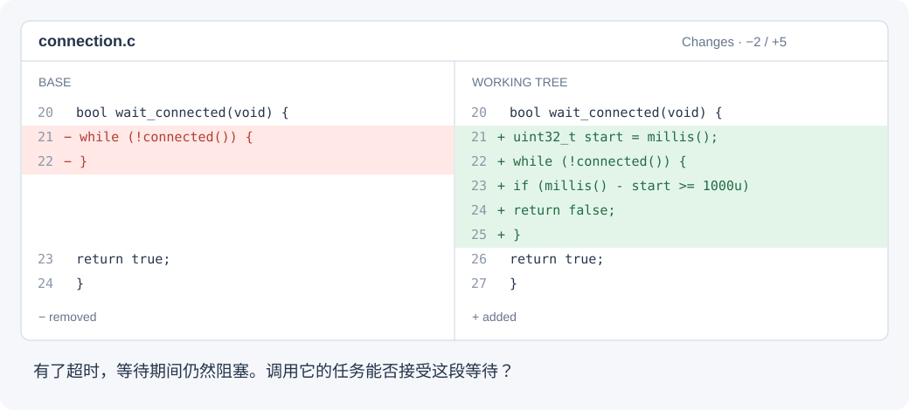

`connected()` 表示连接状态，`millis()` 提供毫秒计时。右侧增加了等待一秒后返回失败的逻辑。Diff 能看清这里加了超时，却不能据此认定改对了。等待会不会妨碍其他任务，调用方有没有处理 `false`，还要回到相关函数、调用位置和状态变化中确认。

例如，任务只是修复通信连接中断后的恢复逻辑，Diff 却顺手改了采样周期、缓冲区大小和公共接口。它们分别影响多久读取一次数据、一次能暂存多少数据，以及其他模块怎样调用这段代码。这些改动未必有错，但要说明它们和任务有什么关系。否则，即使重连功能正常，也看不出其他部分受了什么影响。Agent 的完成说明能帮助找重点，实际接受的修改仍要以 Diff 为准。

Git 为这项工作提供了直接入口：`git diff` 查看尚未暂存的修改，`git diff --staged` 查看准备提交的修改，`git show <commit>` 查看某次提交；GitHub PR 的 Files changed 页面展示分支准备合入的差异。命令、编辑器和网页只是不同入口，目的都是看清这次准备接受哪些修改。

### Review 实现与功能：把代码中的判断带到设备上验证

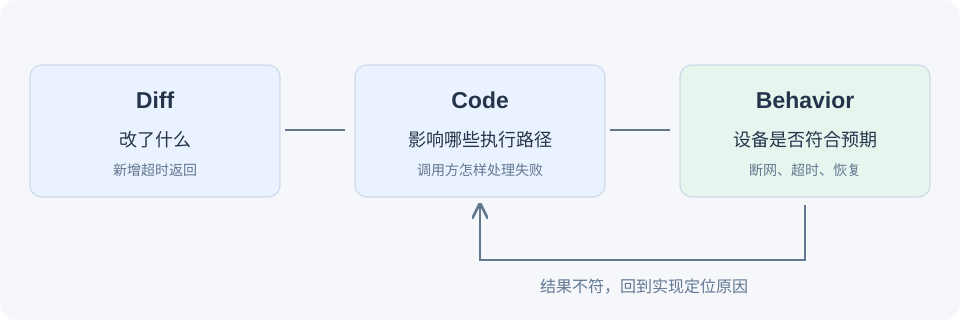

读懂实现以后，才能更有针对性地验证功能。仍以通信恢复为例。代码若声称断开后会超时退出、继续执行其他任务，并在连接恢复后重新接收数据，测试就要实际覆盖这些行为。只检查“连接成功时能收发”，等于没有检验这次修改最重要的部分。

代码审查和运行验证因此要相互补充。阅读代码能发现某条异常路径没有出口；设备测试能观察超时是否合适、恢复后是否正常工作。运行结果和预期不一致时，还要回代码里找原因，不能把偶然成功当成问题已经解决。

Agent 可以帮助解释 Diff、追踪调用关系、寻找遗漏，也能执行具备条件的测试。这些工作的价值，是让开发者有依据决定接受还是拒绝修改。只得到一句“Review 通过”，却不知道查了哪些代码、验了哪些行为，仍然没有理解实现。

测试本身也要审查。需求要求返回所有同名记录，实现和测试却都只处理第一条，测试即使通过，也没有回答真正的问题。尤其在 Agent 同时编写实现和测试时，更要把测试里的预期重新对回需求，不能让现有代码反过来定义什么才算正确。

测试多，也不等于质量高。测试应当约束需要保持的行为，不能把内部实现再抄一遍。如果一调整内部结构，就得同步重写一大片测试，这些测试很可能只是在增加维护负担。先把预期行为写清楚，再据此实现和验证，这就是测试驱动开发。

### AI 工具应当帮助维护者

Linux 内核开发也面对同样的问题。内核里的驱动代码负责让系统操作具体硬件，内存管理决定内存怎样分配，调度决定哪些程序何时运行。这些工作直接涉及硬件与底层运行条件，与嵌入式开发有不少交叉。AI 在这里有没有价值，也要放进实际开发和维护工作里判断。

2026 年 7 月，关于将 AI 审查工具接入补丁工作流（提交修改、等待审查、修正后再次提交）的邮件讨论中，Linus Torvalds 明确支持把 AI 当作工具，同时指出维护者可能因此多出额外工作。他强调，这些工具应当帮助维护者。接受新工具和要求贡献质量，在这个立场里并不冲突。[邮件原文：Re: Linking Patchwork with Sashiko?](https://lore.kernel.org/linux-media/CAHk-=wi4zC+Ze8e+p3tMv8TtG_80KzsZ1syL9anBtmEh5Z40vg@mail.gmail.com/)

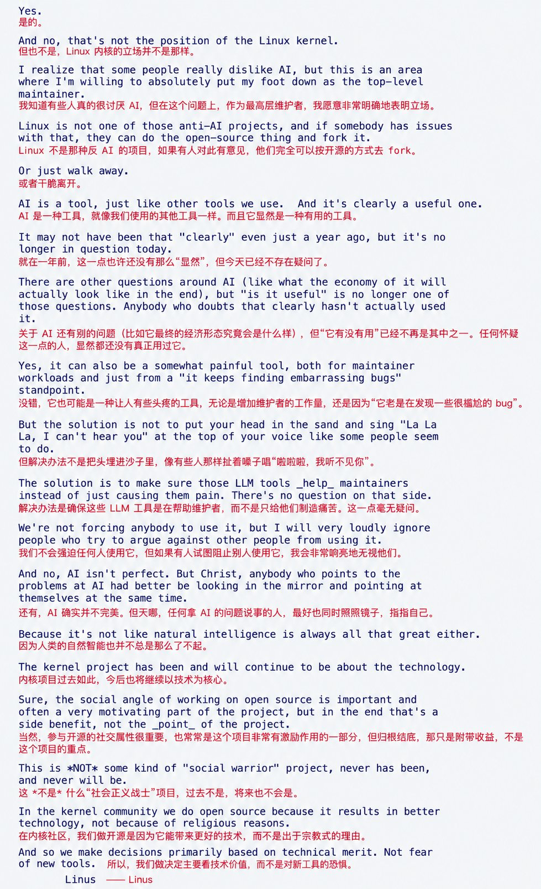

*Linus Torvalds，linux-media 邮件列表，2026 年 7 月；图中中文为附加译文。*

这和 Pi 的贡献要求放在一起看，意思很清楚：用 AI 完成实现，就要同时负起理解、检查和解释修改的责任。嵌入式开发还要面对硬件约束和发布成本，因此这些检查需要做到多深，也要结合具体任务判断。

## 测试驱动开发（TDD）：先把需求写成能够运行的测试

代码生成得越快，越要尽快判断结果是否符合要求。只在实现完成后让 Agent 补测试，很容易写出一组顺着现有代码走的检查：代码漏了一个情况，测试也跟着漏掉。**测试驱动开发（Test-Driven Development，TDD）**把这个顺序倒过来：先明确预期行为、写出测试，再让实现满足它。

以“同名记录应当全部返回”为例，测试数据可以放两条同名记录和一条其他姓名的记录。查询同名姓名时，预期结果必须包含两条记录，不能只检查“结果不为空”。这个预期来自需求，实现还没写出来时，就已经可以确定。

一轮 TDD 通常包含三个短阶段：

1. **Red**：运行新测试，让它因为当前实现缺少所需行为而失败。失败原因必须对得上准备解决的问题；如果只是测试文件没找到或编译环境没配好，还不能证明测试发现了漏查。
2. **Green**：修改实现，让同一条测试通过。
3. **Refactor**：整理重复代码和函数划分，再运行测试，确认行为没有变化。

这三个阶段构成一个短循环，每次只围绕一项明确的行为推进。

在 Agent 结对编程中，可以先按需求审查测试数据和预期结果，再让 Agent 完成实现。测试通过断言（assertion）比较实际结果与预期。出现失败时，要根据失败原因改代码；如果测试本身确实写错了，也要回到需求，说明为什么调整预期。为了让检查变绿就删断言、放宽条件，会把原本明确的要求一起删掉。

修 Bug 时，这个过程尤其直接。先把故障条件写成能够稳定复现的测试，确认旧实现会失败，再完成修复。测试随后留在项目里，检查后面有没有再次引入同样的问题。这类检查叫回归测试。前面的 GitHub Actions 可以在每次 PR 更新时重复运行它，让一次修复不只停在当时的成功上。

### 嵌入式任务怎样应用测试驱动开发

嵌入式代码里，通信协议解析、数据换算和状态转换等逻辑，通常可以先在电脑上测试。串口协议通常把一组连续字节组成一帧，也就是一条完整消息。测试可以覆盖几种情况：完整帧应得到什么结果，数据不完整时怎样等待，校验字段（用于发现数据在传输中受损）不一致时怎样拒绝。测试直接给解析函数一段字节数组就够了，不必等到串口硬件接好才检查解析规则。

这也会影响代码组织。如果解析过程直接混在读取串口的代码里，测试就很难单独给它输入。把接收数据和解析数据分开，测试方便了，硬件相关部分也更容易辨认。这样拆分的目的是让协议行为能够独立检查。

电脑上的测试通过以后，还要把解析逻辑接进真实接收流程。设备运行时会遇到分批到达、缓冲区溢出、通信连接中断、恢复后残留旧数据等情况。TDD 先把能够描述的行为固定下来，硬件测试再检查这些行为在真实条件下是否成立。

时间也是行为的一部分。程序最后算对了，却错过了设备需要结果的时刻，仍然不合格。一次正常演示只经历了一部分事件组合，不能据此推断其他情况也没问题。

这也是 Review 和实际测试都不能少的原因。阅读代码，可以看清一段等待在什么条件下结束、异常后会进入哪条路径；运行设备，可以观察这些路径在真实条件下是否符合预期。Agent 可以分析日志、比较修改，也能借助合适的工具参与测试，但接受结果的人仍要知道这次测了什么，还有什么没有确认。

因此，需求要能说明目标，方案要能解释取舍，实现要能被审查，交付结果要能被验证。开发者要能说明为什么接受这个结果，不能只听模型报告一句“已经完成”。

## 经典软件工程经验为何仍然有效

前面讨论的复杂度、上下文和交付问题，并不是 AI 出现以后才有的。Agent 改变了代码怎样生产，但它仍在参与协作、维护和交付这件软件工程。

《人月神话》讨论软件项目为什么不能只靠增加人力解决进度问题。新人需要时间了解背景，参与者还要对齐接口、同步进度，沟通和交接本身就会增加成本。这本书进一步讨论开发周期、架构一致性、团队维护和项目交接。

《代码整洁之道》关注代码怎样保持可读和可修改，包括命名、函数边界和错误处理。它提供的是整理实现的方法，并不直接决定产品要做什么。

这些经典著作处理的是软件生命周期、团队协作、架构和长期维护。Agent 改变了代码由谁生产，产品目标、架构取舍、团队协调和发布责任仍然存在，因此这些长期问题不会自动消失。

多叫一个 Agent 很快，但每个参与者都要了解背景、和其他模块保持一致，最后还要整合和核查。三个 Agent 各用一种文件格式，各自都完成了任务，合起来仍然没法用。[《Agent 时代的人月神话》](https://github.com/Meari-Prototype/agent-mythical-man-month-2026)适合和原书对照着读，看看协调成本怎样在新工具下重新出现。

经典经验也要结合条件理解。命名清楚有助于阅读，但把完整逻辑切成许多短函数，项目未必更清楚；减少重复知识有价值，过早把不同职责合在一起，却可能增加耦合。

所以，真正要学的是问题、理由和取舍。具体做法会随语言和工具变化，有些旧方法可以淘汰，有些长期问题仍值得研究。尊重经典，不等于每条建议都原样照做。

[Piglei 的《AI 编程是一种“框架”》](https://www.piglei.com/articles/ai-programming-is-a-new-framework/)讨论了便利背后的控制权与认知成本；[《一份关于 AI 编程的简明行为指南》](https://www.piglei.com/articles/a-simple-ai-coding-guide-for-engineers/)则讨论协作、验证和责任。它们适合与这些工程问题放在一起阅读，理解不同实践者作出建议的背景。

## 持续学习：模型、工具与经验都在变化

经典经验帮助理解长期问题，模型和工具的具体能力则需要持续更新。过去很难完成的任务，可能在新版本里变得容易；过去需要的提示词和辅助流程，也可能被产品内置功能替代。

所以，Agent 结对编程没有一套学完就能永久沿用的配置。模型、Harness、工具接口和项目条件都会变。积极使用新技术，也包括回头检查原来的工作方法还有没有必要。

变化很快，也不必每天都推翻全部经验。要分清一条判断究竟来自某个模型版本的局限，还是来自工程本身的约束。前者随着能力变化需要更新，后者仍要结合具体需求继续处理。

### 模型发布信息怎样联系实际能力

前面介绍的参数、Token、上下文和工具调用，可以帮助理解厂商的发布信息。发布文章讲新增能力，技术报告讲训练和评测，模型卡片集中列出可使用的规格、限制和接入方式。

千问就是一个直观例子。同一个品牌下可以有不同大小、不同结构和不同用途的模型。以 [2025 年发布的 Qwen3](https://qwenlm.github.io/blog/qwen3/)为例，8B 表示约 80 亿参数；30B-A3B 表示总参数约 300 亿，每个 Token 激活约 30 亿。

后者背后的模型并不会让每个 Token 都经过全部网络组件。模型内部保存许多负责计算的组件，但每个 Token 只选用其中一部分。这种安排叫混合专家（Mixture of Experts，MoE），被选用的组件通常称作“专家”。它们不是多个独立 Agent。激活参数影响计算量，部署时仍要考虑全部参数（也称为权重）需要多少存储空间。

模态指文字、图像、语音等信息形式。参数规模描述模型有多大，上下文长度描述一次能容纳多少信息，输入与输出模态决定它能处理哪些形式的内容。它们回答的是不同问题，不能合成一句“越大越好”。

同一生态中还有视觉模型、语音模型和用于检索的向量嵌入模型。检索模型把整段文本变成向量，用来查找意思相关的材料；生成模型再利用查到的材料回答问题。应用可以按需要把这些能力组合起来。

厂商提供的 API、应用接入的模型和 Harness 提供的工具，共同决定最终体验。所以，更新模型和更新 Agent 应用可能改善不同环节：前者提高理解或生成能力，后者改善信息获取、执行和协作方式。

### 基准测试（Benchmark）衡量的是特定条件下的表现

评价模型时，评测者会挑选一组任务，规定输入、执行条件和评分方式，再统计模型完成了多少。这样组织起来的基准测试（Benchmark）可以是函数补全、仓库问题修复，也可以是图片识别。它们测的是不同能力，即使都用百分比显示，也不能直接互相替代。

Agent 编程评测还受执行系统影响。系统能搜索仓库、运行测试，还允许多轮修正，与只生成一次答案的模型相比，取得成绩的条件并不一样。

pass@1 与 pass@k 等指标反映尝试次数不同：一次能不能完成，和多个候选里至少有一个成功，并不是同一种使用体验。推理时间、工具配置和计算预算，也要一起看。

发布结果可以帮助判断新能力是否值得关注，却不能替代项目里的实际观察。一次成绩查询任务和一个背了多年兼容负担的软件仓库，要求并不相同。工具到底有没有改善工作，还要算上审查、返工和维护的成本。

## 信息来源与自主学习

技术一直在变，学习就不能只发生在上课时。模型更新了能力，编程工具改变了工作方式，嵌入式项目换了芯片和开发框架，原来那套做法都可能需要重新理解。持续学习首先要解决的，是这些变化从哪里进入视野。

### 一手信息与二手信息怎样区分

新模型发布后，模型团队会自己说明训练方法、公布评测结果；工具增加功能时，开发者也常直接解释改了哪里。这些由工作参与者写下的记录、数据和经验，构成了某项事实或成果的一手信息。要了解新模型或新功能，发布文章、原始论文和官方文档通常是很好的起点。

另一位作者读完这些资料，再挑重点、解释术语、整理成教程，其中针对原始成果的这一部分就成了二手信息。它更适合初学者，也可能漏掉原文的适用条件。二手不一定低质，一手也不一定完整、公正，关键区别是中间隔了几层解释。

例如，芯片手册写明设备在什么条件下会把某个标志设为异常、程序又该何时清除，这是硬件提供方定义的接口，属于一手资料；教程把规定改写成操作步骤，就隔了一层解释。如果作者又发现某类故障总在特定操作顺序下出现，并记录接线、代码和测量结果，这部分经验来自作者亲自实践，同样属于一手信息。同一篇文章里，可以同时有转述和原创。

判断信息属于哪一种，要看内容从哪里来。读完教程以后，可以顺着引用继续核对手册或实验；遇到原创经验，则要关注硬件条件、软件版本和验证过程。

### 社区经验本身也是一手资料

一手资料不只来自官方。实践者记录自己的调试过程、解释方案取舍、提出新观点，这些内容就是经验的直接来源。博客和信息流里既有转述，也有原创，要按内容区分。

开源代码展示的是最后留下来的实现，却未必解释为什么这样做。失败过的方案、环境限制和调试时的发现，往往要在文章、Issue 和 PR 里才看得到。阅读这些内容，能补上单看源码无法还原的经验。

所以，社区作者不只是解释技术的“翻译官”，也可能提出新的观点。与不同实践者交流，能看到不同项目条件下的判断。这和等着传统教师一项项传授知识，是两种不同的学习关系。

[Piglei 的两篇文章](https://www.piglei.com/articles/a-simple-ai-coding-guide-for-engineers/)与[关于 AI 编程框架的讨论](https://www.piglei.com/articles/ai-programming-is-a-new-framework/)分别发表于 2026 年 3 月和 2 月。当时 AI 编程工具已经迭代了一段时间，文章记录了那个阶段的实践认识。后面的工具仍在变化，其中的能力判断也要放回当时的时间背景来看。

### 持续学习为什么不必依赖固定教师

传统教学由教师先理解材料、安排顺序，再按学习者能接受的节奏讲解。这项工作有价值，但技术迭代很快，教师也需要持续阅读和实践。如果学习只能等固定教师准备下一节课，获取信息就会受制于他的关注范围、更新时间和讲课安排。

更主动的办法是直接拿到资料，再寻找理解它所需要的帮助。面对同一份资料，AI 能解释术语、翻译段落、更换例子，也能借助搜索和文档工具查找更新记录。知识转述、基础讲解和反复答疑，因此不必始终由一位固定的人类教师承担。学习者可以按自己的节奏追问，并把实际项目带进讨论。

### 导师（Mentor）提供的是指导与反馈

不依赖固定教师，不等于不需要指导。导师（Mentor）更接近一个能够讨论判断的人：帮助辨认真正的问题，理解方案取舍，指出还没注意到的条件，并对实践结果给出反馈。这种关系不必由一个人长期包办，也不取决于对方有没有教师身份。

例如，通信程序能够编译，开始时也能正常收发；设备连续运行一段时间后，数据却开始丢失。编译通过只说明代码能够生成程序，不能证明长时间运行的行为。AI 可以帮忙阅读收发代码、解释缓冲区怎样暂存数据；做过同类项目的学长可能提醒检查中断和日志输出；社区维护者则可能知道所用软件版本存在已知问题。这些指导来自不同地方，可以围绕同一故障互相补充。

导师可以是 AI、学长、同事，也可以是社区里愿意交流的人。找谁帮助，要看眼下问题和手上的信息渠道：解释概念可以借助 AI；判断实物现象，更需要测量设备和有相关经验的人；理解项目内部约定，则要阅读维护者的讨论并向他们请教。

导师也不必对所有问题都有答案。面对新模型、新工具或没遇到过的硬件问题，可以一起找资料、提假设、设计验证，再按结果修正判断。

### AI 怎样参与具体的学习

学习者已经会写 C 函数，却没接触过网络 API。结合官方文档，AI 可以解释请求和返回值怎样对应，再把它联系到模型调用。能够检索的 AI 还可以帮助找文档、比较版本、整理相关讨论。

这些便利仍要和思考、实践结合。代码行为可以通过运行观察，接口定义可以回到文档核对，设计建议可以放进交付条件里讨论。解释得流畅，还要靠这些联系来确认理解是否真的正确。

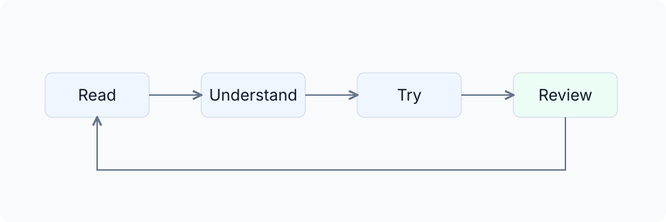

“学而不思则罔，思而不学则殆。”阅读让经验不只来自亲手做过的项目，思考帮助判断别人的结论为什么成立，实践则形成新的认识。AI 可以参与每一环，但不能让这些环节彼此断开。

### 建立信息渠道，而非寻找永久答案

官方资料、开源社区、个人博客和经典著作可以共同构成学习来源。它们分别提供产品变化、实现与讨论、实践经验，以及对长期问题的分析。

RSS 是一种订阅网站更新内容的信息格式，阅读器和部分应用可以从订阅源集中取得新文章。RSS、邮件订阅和书签都能帮助整理这些渠道，用哪一种取决于个人习惯。更重要的是能找到原始出处，知道观点怎样形成，并在工具变化后重新判断。

[Tw93 的《你不知道的 Agent：原理、架构与工程实践》](https://tw93.fun/2026-03-21/agent.html)适合继续理解模型、工具与 Harness 的联系，[“你不知道的”系列](https://tw93.fun/)也值得持续阅读。大模型原理可以继续观看前面推荐的《大模型进化论》，工程问题则可以结合《人月神话》《代码整洁之道》和社区实践讨论。

Agent 结对编程的工作方法也将在这样的学习中变化。具体表达习惯、工具组合与协作节奏可以不同，但对项目的理解不能停留在一个愿望上：开发者需要知道正在交付什么，为什么采用当前设计，以及实际结果是否兑现了这些要求。
